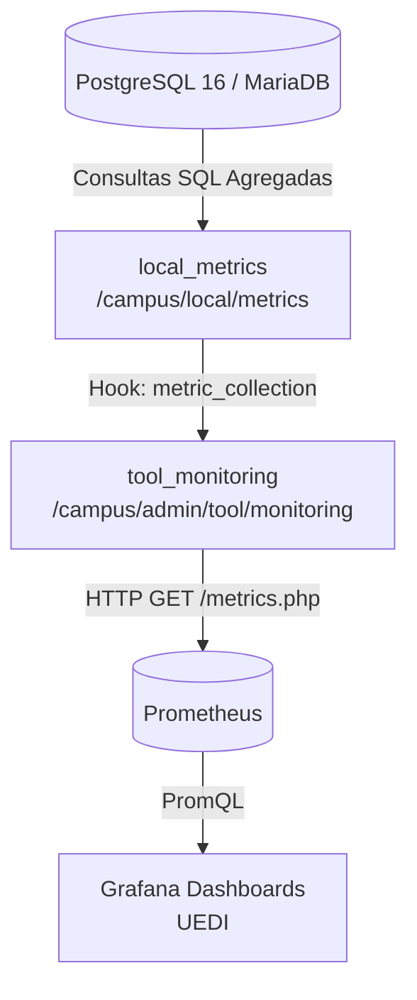

# moodle-local_metrics

[](https://moodle.org)
[](https://www.php.net)
[](LICENSE.md)
[](https://prometheus.io)
[](https://www.postgresql.org)

**Métricas Académicas para Moodle (Facultad de Ingeniería - USAC / UEDi).**

`local_metrics` es un plugin local satélite para Moodle que implementa y expone **38 métricas académicas de alto rendimiento**. Se integra de forma nativa y desacoplada con el plugin oficial [`tool_monitoring`](https://moodle.org/plugins/tool_monitoring) mediante la **Moodle Hooks API** (`\tool_monitoring\hook\metric_collection`), exportando datos directamente a **Prometheus** y **Grafana**.

---

## 📑 Tabla de Contenidos

- [Arquitectura y Desacoplamiento](#-arquitectura-y-desacoplamiento)
- [Catálogo de Métricas (38)](#-catálogo-de-métricas-38)
  - [Actividad y Usuarios (13)](#1-actividad-y-usuarios)
  - [Tareas / Assignments (6)](#2-tareas-y-entregas-assignments)
  - [Cuestionarios / Quizzes (7)](#3-cuestionarios-y-evaluaciones-quizzes)
  - [Cursos y Matrículas (12)](#4-cursos-y-matrículas)
- [Optimizaciones para Alto Rendimiento](#-optimizaciones-para-alto-rendimiento)
- [Requisitos](#-requisitos)
- [Instalación](#-instalación)
- [Configuración](#-configuración)
- [Verificación y Monitoreo](#-verificación-y-monitoreo)
- [Compatibilidad con Moodle 5.0+](#-compatibilidad-con-moodle-50)
- [Licencia y Créditos](#-licencia-y-créditos)

---

## 🏛 Arquitectura y Desacoplamiento

El plugin fue diseñado bajo el principio de **cero invasión**: no altera ninguna tabla existente de Moodle ni modifica archivos del núcleo. Aprovecha el sistema de ganchos PSR-14 de Moodle para registrar las métricas en `tool_monitoring`, permitiendo que el exportador oficial de Prometheus recolecte las métricas sin modificar su código base.



Todas las métricas producidas por este plugin son expuestas en Prometheus bajo el prefijo **`local_metrics_`**, manteniéndolas separadas y ordenadas respecto a las métricas del sistema (`tool_monitoring_`).

---

## 📊 Catálogo de Métricas (38)

### 1. Actividad y Usuarios

| Métrica en Prometheus | Tipo | Dimensiones / Etiquetas | Descripción |
| :--- | :---: | :--- | :--- |
| `local_metrics_active_students` | Gauge | `school` | Estudiantes con actividad reciente dentro de la ventana configurada, agrupados por escuela. |
| `local_metrics_active_teachers` | Gauge | `school` | Docentes con actividad reciente dentro de la ventana configurada, agrupados por escuela. |
| `local_metrics_student_logins` | Gauge | `school` | Total de inicios de sesión de estudiantes en la ventana temporal. |
| `local_metrics_new_users` | Gauge | *(ninguna)* | Total de usuarios creados en los últimos 30 días. |
| `local_metrics_inactive_users` | Gauge | `time_window` | Usuarios sin actividad en ventanas de 7, 15 y 30 días. |
| `local_metrics_users_never_logged_in` | Gauge | *(ninguna)* | Cuentas existentes que jamás han iniciado sesión. |
| `local_metrics_last_activity_age` | Gauge | `bucket` | Distribución del tiempo transcurrido desde el último acceso de los usuarios. |
| `local_metrics_activity_by_day` | Gauge | `day` | Volumen de eventos de actividad distribuidos por día de la semana. |
| `local_metrics_activity_by_hour` | Gauge | `hour` | Volumen de eventos de actividad distribuidos por hora del día (0-23h). |
| `local_metrics_activity_by_week` | Gauge | `week` | Volumen de eventos de actividad agregados semanalmente. |
| `local_metrics_activity_events` | Gauge | *(ninguna)* | Total absoluto de eventos registrados en el log de Moodle. |
| `local_metrics_activity_events_by_type` | Gauge | `action` | Conteo de eventos agrupados por tipo de acción (`create`, `read`, `update`, `delete`). |
| `local_metrics_module_views` | Gauge | `module` | Visualizaciones registradas por tipo de módulo Moodle (`assign`, `quiz`, `forum`, `resource`, etc.). |

### 2. Tareas y Entregas (Assignments)

| Métrica en Prometheus | Tipo | Dimensiones / Etiquetas | Descripción |
| :--- | :---: | :--- | :--- |
| `local_metrics_assignments_by_dimension` | Gauge | `school`, `year`, `period`, `course`, `status` | Cantidad de tareas categorizadas por estado (`upcoming`, `open`, `closed`). |
| `local_metrics_assignments_pending_grading` | Gauge | `school`, `year`, `period`, `course` | Tareas entregadas por estudiantes que aún no han sido calificadas por el docente. |
| `local_metrics_assignment_submissions_by_timing` | Gauge | `school`, `year`, `period`, `course`, `timing` | Entregas de tareas clasificadas según puntualidad (`on_time` vs `late`). |
| `local_metrics_average_grading_delay` | Gauge | `school`, `year`, `period`, `course` | Tiempo promedio (en días) que tarda el docente en asentar la calificación desde la entrega. |
| `local_metrics_expected_submissions_by_dimension`| Gauge | `school`, `year`, `period`, `course` | Total de entregas esperadas según estudiantes inscritos en tareas activas. |
| `local_metrics_submissions_missing` | Gauge | `school`, `year`, `period`, `course` | Cantidad de entregas no realizadas en tareas cuya fecha límite ya venció. |

### 3. Cuestionarios y Evaluaciones (Quizzes)

| Métrica en Prometheus | Tipo | Dimensiones / Etiquetas | Descripción |
| :--- | :---: | :--- | :--- |
| `local_metrics_quizzes_by_dimension` | Gauge | `school`, `year`, `period`, `course`, `status` | Cantidad de cuestionarios por estado (`upcoming`, `open`, `closed`). |
| `local_metrics_quiz_attempting_students` | Gauge | `school`, `year`, `period`, `course` | Cantidad de estudiantes únicos que han realizado al menos un intento. |
| `local_metrics_quiz_attempts_by_state` | Gauge | `school`, `year`, `period`, `course`, `state` | Intentos de cuestionario según estado (`inprogress`, `finished`, `abandoned`). |
| `local_metrics_quiz_average_grade` | Gauge | `school`, `year`, `period`, `course` | Calificación promedio obtenida por los estudiantes sobre escala estandarizada a 100 puntos. |
| `local_metrics_quiz_grade_results` | Gauge | `school`, `year`, `period`, `course`, `result` | Distribución de resultados de cuestionarios (`approved` vs `failed`). |
| `local_metrics_average_quiz_duration` | Gauge | `school`, `year`, `period`, `course` | Duración promedio (en minutos) empleada por intento finalizado. |
| `local_metrics_students_without_quiz_attempt` | Gauge | `school`, `year`, `period`, `course` | Estudiantes matriculados que no realizaron ningún intento en exámenes cerrados. |

### 4. Cursos y Matrículas

| Métrica en Prometheus | Tipo | Dimensiones / Etiquetas | Descripción |
| :--- | :---: | :--- | :--- |
| `local_metrics_courses_active` | Gauge | `school` | Cursos que registran actividad en la ventana temporal, por escuela. |
| `local_metrics_courses_by_dimension` | Gauge | `school`, `year`, `period` | Distribución total de cursos por escuela, año y período académico. |
| `local_metrics_courses_without_students` | Gauge | `school`, `year`, `period`, `course` | Cursos activos en el período que no tienen ningún estudiante matriculado. |
| `local_metrics_courses_without_teachers` | Gauge | `school`, `year`, `period`, `course` | Cursos activos en el período que no tienen ningún docente asignado. |
| `local_metrics_enrolments_by_method` | Gauge | `method` | Total de matrículas activas clasificadas por método de inscripción (`manual`, `self`, `sync`). |
| `local_metrics_enrolments_by_status` | Gauge | `status` | Total de matrículas clasificadas por estado (`active`, `suspended`). |
| `local_metrics_enrolments_total` | Gauge | *(ninguna)* | Total global de registros de matrícula en la plataforma. |
| `local_metrics_role_enrolments` | Gauge | `role` | Asignaciones de rol activas en contextos de curso (`student`, `editingteacher`, etc.). |
| `local_metrics_students_enrolled` | Gauge | `school` | Cantidad neta de estudiantes únicos matriculados por escuela. |
| `local_metrics_students_per_course` | Gauge | `school`, `year`, `period`, `course` | Número de estudiantes inscritos por curso individual. |
| `local_metrics_students_multiple_courses`| Gauge | `threshold` | Conteo de estudiantes inscritos en más de 3, 5 o 7 cursos simultáneamente. |
| `local_metrics_unique_course_users` | Gauge | `school` | Total de usuarios únicos con algún rol en cursos de cada escuela. |

---

## ⚡ Optimizaciones para Alto Rendimiento

El plugin fue probado y optimizado rigurosamente contra una base de datos institucional en producción de **11.2 GB**, conteniendo más de **1.63 millones de entregas** (`mdl_assign_submission`) y **637,000 intentos de evaluación** (`mdl_quiz_attempts`):

1. **Agregación en Motor de BD:** Todo el agrupamiento (`GROUP BY`, `SUM`, `COUNT`) se delega directamente a PostgreSQL/MySQL en lugar de iterar millones de registros en la memoria RAM de PHP.
2. **Prevención de Degradación de Plan de Consulta en PostgreSQL:** En consultas de anti-join (como tareas pendientes de calificar o estudiantes sin intentos), se utiliza `$DB->get_records_sql` en lugar de cursores (`get_recordset_sql`), permitiendo que el optimizador de PostgreSQL elija *Hash Anti-Joins* en lugar de *Nested Loops*, reduciendo el tiempo de cálculo de **157.28s a solo 2.25s**.
3. **Detección Dinámica de Motor de Base de Datos:** `academic_queries` detecta automáticamente el dialecto mediante `$DB->get_dbfamily()`, adaptando funciones de texto y regex:
   - **PostgreSQL:** Utiliza `split_part(path, '/', N)` y expresiones regulares POSIX (`~`).
   - **MariaDB / MySQL:** Utiliza `SUBSTRING_INDEX(path, '/', N)` y `REGEXP`.

---

## 📦 Requisitos

- **Moodle:** 4.5.0 o superior (compatible nativamente con Moodle 5.0+).
- **PHP:** 8.1, 8.2 o 8.3+.
- **Base de datos:** PostgreSQL 14+ / 16+ o MariaDB 10.6+ / MySQL 8.0+.
- **Plugin Requerido:** [`tool_monitoring`](https://moodle.org/plugins/tool_monitoring) instalado en `admin/tool/monitoring/`.

---

## 🚀 Instalación

1. Clona el repositorio dentro del directorio `/local/metrics/` de tu instalación de Moodle:
   ```bash
   git clone https://github.com/Ennero/moodle-local_metrics.git local/metrics
   ```

2. Otorga los permisos adecuados para el servidor web:
   ```bash
   chown -R www-data:www-data local/metrics
   ```

3. Ejecuta la instalación no interactiva mediante la CLI de Moodle:
   ```bash
   sudo -u www-data php admin/cli/upgrade.php --non-interactive
   ```

4. Purga la caché de Moodle para registrar los hooks:
   ```bash
   sudo -u www-data php admin/cli/purge_caches.php
   ```

---

## ⚙️ Configuración

Las métricas que requieren parámetros de ventana temporal cuentan con clases de configuración dedicadas:

- **`window_config` (`windowdays`):** Tamaño de la ventana de actividad reciente en días (valor predeterminado: `30` días).
- **`windows_config` (`windowdays`):** Lista de ventanas temporales separadas por comas para inactividad (valor predeterminado: `7,15,30` días).

---

## 🔍 Verificación y Monitoreo

Para comprobar que las 38 métricas están activas y siendo recolectadas por `tool_monitoring`, puedes realizar una solicitud al endpoint de Prometheus:

```bash
curl -H "Authorization: Bearer <TU_PROMETHEUS_TOKEN>" \
     http://tu-moodle.edu.gt/admin/tool/monitoring/exporter/prometheus/metrics.php
```

Salida esperada (extracto):
```text
# HELP local_metrics_active_students Métrica: estudiantes con actividad reciente, por escuela.
# TYPE local_metrics_active_students gauge
local_metrics_active_students{school="Escuela de CIENCIAS Y SISTEMAS"} 2245
local_metrics_active_students{school="Escuela de CIVIL"} 1891

# HELP local_metrics_assignments_pending_grading Tareas pendientes de calificar por curso.
# TYPE local_metrics_assignments_pending_grading gauge
local_metrics_assignments_pending_grading{school="Escuela de CIENCIAS Y SISTEMAS", course="IPC1"} 14
```

---

## 🔄 Compatibilidad con Moodle 5.0+

Dado que `local_metrics` utiliza exclusivamente la **Hooks API oficial de Moodle** y la clase abstracta `\tool_monitoring\metric`, el plugin es **100% inmune a cambios internos del núcleo de Moodle**:

* Cuando se actualice el campus a **Moodle 5.0**, el plugin `tool_monitoring` se puede actualizar o reemplazar directamente desde el repositorio oficial de Moodle.org.
* `local_metrics` continuará registrándose automáticamente sin requerir adaptaciones ni trabajo manual.

---

## 📄 Licencia y Créditos

Este plugin es software libre desarrollado para la **Unidad de Educación a Distancia (UEDi)** de la **Facultad de Ingeniería de la Universidad de San Carlos de Guatemala (USAC)**.

Distribuido bajo los términos de la [GNU General Public License v3.0 or later (GPL-3.0-or-later)](LICENSE.md).
